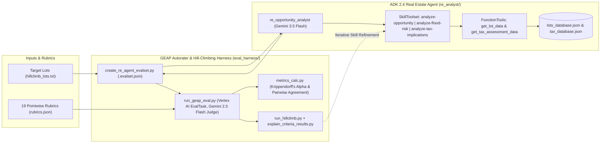

# FDE — Secure AI Agents: Real Estate Investment Analyst & Vertex AI GEAP Autorater Framework

An end-to-end **Google Agent Development Kit (ADK 2.4.0)** multi-skill agent and **Vertex AI GenAI Evaluation Service (GEAP)** statistical autorater & hill-climbing framework for automated real estate due diligence.

---

## Documentation Hub

| Document | Description |
| :--- | :--- |
| **[Architecture & Detailed Workflows (`docs/ARCHITECTURE.md`)](docs/ARCHITECTURE.md)** | System topology, multi-skill tool-calling sequence diagrams, GEAP stochastic $k$-pass evaluation pipeline, Krippendorff's $\alpha$ rubric triage decision tree, hill-climbing state machine, data schemas, and security/reliability guardrails. |
| **[Step-by-Step Operational Runbook (`docs/RUNBOOK.md`)](docs/RUNBOOK.md)** | Copy-pasteable operational guide covering GCP/ADC setup, Python 3.13 environment bootstrap, ADK Web UI testing, `EvalSet` trace generation, GEAP cloud runs, rubric agreement auditing, hill-climbing remediation, and troubleshooting. |

---

## High-Level System Architecture



---

## Key Capabilities & Empirical Results

### 1. Grounded Multi-Skill Real Estate Analysis (`re_analyst/`)
- **Modular Progressive Skills (`SkillToolset`)**: Separates valuation (`analyze-opportunity`), hydrological & neighboring parcel risk (`analyze-flood-risk`), and county APN tax carrying cost analysis (`analyze-tax-implications`) from core agent orchestration.
- **Anti-Hallucination & Cross-Parcel Verification**: Queries `lots_database.json` for both the subject lot and every neighboring parcel in `adjacent_parcels`, joins county tax records via `parcel_apn` in `tax_database.json`, and enforces strict missing-value and hydrological inference guardrails.

### 2. Psychometric Autorater Validation (`Krippendorff's Alpha`)
Evaluates 19 candidate LLM-as-a-Judge rubrics across multiple stochastic passes to separate trustworthy, high-discrimination rubrics from ceiling-saturated (`sd_report_means = 0`) or subjective/noisy criteria:

| Validated Criterion ID | Criterion Name | Krippendorff's $\alpha$ | Pairwise % Agreement | `sd_report_means` |
| :--- | :--- | :---: | :---: | :---: |
| **`monthly-tax-holding`** | Monthly Tax Holding Cost Calculation | **0.997** | **99.17%** | `0.8872` |
| **`flood-zone-flagging`** | Precise Flood Zone Flagging | **0.897** | **94.41%** | `0.3357` |
| **`environmental-esa`** | Environmental Status (Phase I ESA) Evaluation | **0.897** | **79.10%** | `0.7042` |

### 3. Closed-Loop Agent Hill-Climbing (`1.00 -> 5.00`)
Using automated versioned runs (`run_hillclimb.py`) and LLM judge rationale inspection (`explain_criteria_results.py`), targeted refinements to `SKILL.md` drove full convergence across all 10 evaluation properties:

| Criterion | Baseline (`hillclimb_1`) | Intermediate (`hillclimb_2`) | Final (`hillclimb_3`) | Gain |
| :--- | :---: | :---: | :---: | :---: |
| **`cost-per-acre`** | `1.0000` | `1.2000` | **`5.0000`** | **+4.0000** |
| **`neighboring-flood-risk`** | `1.1000` | `1.0000` | **`5.0000`** | **+3.9000** |

---

## Repository Structure

```text
.
├── README.md                              # Project overview, quickstart & benchmark summary
├── .env.example                           # Sanitized environment variable template
├── .gitignore                             # Excludes .env, .adk/ session DBs, and Python caches
├── requirements.txt                       # Pinned ADK 2.4.0, Vertex AI Eval 1.160.0 & stats deps
├── best_criteria_submission.txt           # Top 3 validated high-alpha discriminative criteria
├── docs/
│   ├── ARCHITECTURE.md                    # Detailed architecture & 5 Mermaid workflow diagrams
│   └── RUNBOOK.md                         # End-to-end step-by-step operational runbook
├── re_analyst/                            # Google ADK Real Estate Analyst Agent
│   ├── agent.py                           # Root Agent, Gemini config & SkillToolset wiring
│   ├── skills/
│   │   ├── analyze-opportunity/SKILL.md   # Valuation, Cost/Acre formula & orchestration skill
│   │   ├── analyze-flood-risk/SKILL.md    # Subject + adjacent_parcels hydrological risk skill
│   │   └── analyze-tax-implications/SKILL.md # APN tax lookup & holding cost skill
│   ├── tools/
│   │   ├── lot_tool.py                    # Cached county parcel lookup (get_lot_data)
│   │   └── tax_tool.py                    # Cached APN tax assessment lookup (get_tax_assessment_data)
│   └── *.evalset.json                     # Populated ADK 2.0 evaluation trace datasets
├── eval_harness/                          # GEAP Evaluation & Statistical Reliability Engine
│   ├── create_re_agent_evalset.py         # Concurrent ADK Runner trace generator
│   ├── run_geap_eval.py                   # Vertex AI GEAP EvalTask runner & prompt assembler
│   ├── rubrics.json                       # 19 pointwise evaluation criteria (1-5 Likert scales)
│   ├── hillclimb_lots.txt                 # 10 target evaluation property Lot IDs
│   ├── metrics_calc.py                    # Krippendorff's Alpha & variance statistical engine
│   ├── all_criteria_analysis.py           # Global 19-criteria reliability summary table CLI
│   ├── single_criterion_analysis.py       # Single-criterion N x k Grades Matrix CLI
│   ├── explain_criteria_results.py        # Judge score & failure rationale inspector CLI
│   ├── run_hillclimb.py                   # Automated versioned hill-climbing harness
│   └── utils.py                           # Dynamic ADK app loader & DataFrame pivot helpers
├── tools_data/                            # Local structured domain databases
│   ├── lots_database.json                 # Parcel specs, zoning, FEMA flood zones & neighbors
│   └── tax_database.json                  # County tax assessments indexed by parcel_apn
└── runs/                                  # Versioned GEAP evaluation call & response logs
    ├── baseline/                          # Multi-pass (k=3) baseline GEAP outputs
    ├── hillclimb_1/                       # Iteration 1 baseline hill-climbing results
    ├── hillclimb_2/                       # Iteration 2 diagnostic hill-climbing results
    ├── hillclimb_3/                       # Iteration 3 converged (5.0 / 5.0) results
    └── geap_calls_and_responses_for_analysis.json # Full multi-pass benchmark dataset
```

---

## Quickstart

```bash
# 1. Configure environment
cp .env.example .env
# Edit .env to set GOOGLE_CLOUD_PROJECT=<your-project-id>
gcloud auth application-default login
python3 -m pip install -r requirements.txt

# 2. Generate ADK agent traces across 10 properties
python3 -m eval_harness.create_re_agent_evalset \
  --lots-file eval_harness/hillclimb_lots.txt \
  --out ./re_analyst/hillclimb_lots.evalset.json \
  --agent-dir ./re_analyst

# 3. Audit rubric inter-rater reliability (Krippendorff's Alpha)
python3 -m eval_harness.all_criteria_analysis \
  --run_geap_eval_out runs/geap_calls_and_responses_for_analysis.json

# 4. Run automated hill-climbing iteration
python3 -m eval_harness.run_hillclimb
```

For full step-by-step instructions, interactive ADK Web UI testing, and troubleshooting, see **[`docs/RUNBOOK.md`](docs/RUNBOOK.md)**.
