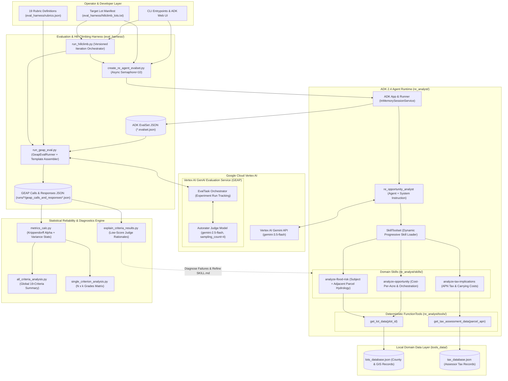
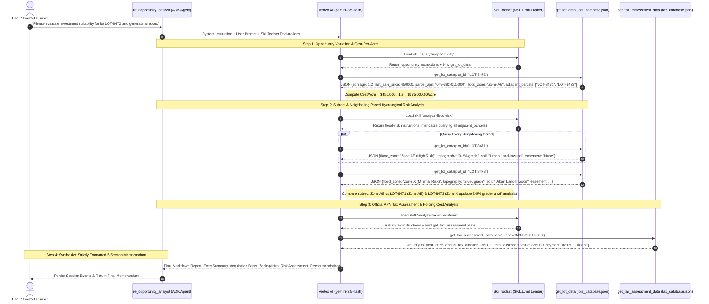
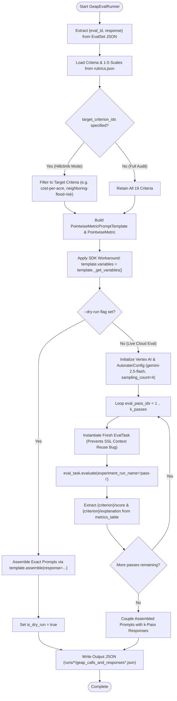
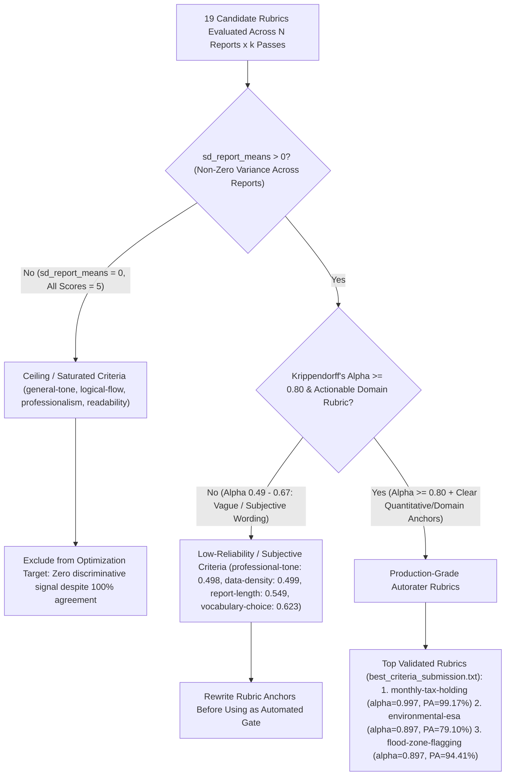
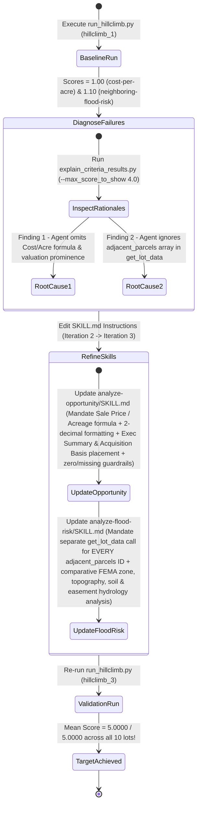

# Architecture & Detailed Workflows: Secure AI Real Estate Analyst & GEAP Autorater Framework

> [!IMPORTANT]
> This document details the end-to-end system architecture, runtime component topology, multi-skill execution sequences, stochastic LLM-as-a-Judge evaluation pipelines, statistical inter-rater reliability analytics, and closed-loop agent hill-climbing workflows implemented in this repository.

---

## Table of Contents

1. [Architectural Overview](#1-architectural-overview)
2. [System Component Topology](#2-system-component-topology)
3. [Workflow 1: Multi-Skill Agent Investigation & Memorandum Generation](#3-workflow-1-multi-skill-agent-investigation--memorandum-generation)
4. [Workflow 2: Concurrent ADK EvalSet Trace Generation](#4-workflow-2-concurrent-adk-evalset-trace-generation)
5. [Workflow 3: Vertex AI GEAP Stochastic Multi-Pass Evaluation](#5-workflow-3-vertex-ai-geap-stochastic-multi-pass-evaluation)
6. [Workflow 4: Inter-Rater Reliability & Rubric Selection Triage](#6-workflow-4-inter-rater-reliability--rubric-selection-triage)
7. [Workflow 5: Closed-Loop Agent Hill-Climbing Optimization](#7-workflow-5-closed-loop-agent-hill-climbing-optimization)
8. [Data Contracts & Schema Specifications](#8-data-contracts--schema-specifications)
9. [Security, Guardrails & Reliability Engineering](#9-security-guardrails--reliability-engineering)

---

## 1. Architectural Overview

Evaluating domain-specific AI agents requires two tightly coupled capabilities:
1. **Grounded Agentic Execution**: A modular AI agent built on **Google Agent Development Kit (ADK 2.4.0)** (`re_opportunity_analyst`) that dynamically loads specialized domain skills (`SkillToolset`) and invokes deterministic data-retrieval tools (`FunctionTool`) without hallucinating financial or hydrological facts.
2. **Statistically Rigorous Autorater Governance**: An automated evaluation harness (`eval_harness/`) backed by **Vertex AI GenAI Evaluation Service (GEAP)** that executes $k$ stochastic LLM-as-a-Judge passes per rubric, measures inter-rater agreement via **Krippendorff's Alpha ($\alpha$)** and pairwise agreement, filters out noisy or ceiling-saturated rubrics, and drives iterative **hill-climbing** improvements on agent skills.

### Core Technology Stack

| Layer | Component | Implementation / Version | Purpose |
| :--- | :--- | :--- | :--- |
| **Agent Framework** | Google ADK | `google-adk==2.4.0` | `Agent`, `App`, `Runner`, `InMemorySessionService`, `SkillToolset`, `FunctionTool` |
| **Agent Model** | Vertex AI Gemini | `gemini-3.5-flash` (configurable via `.env`) | Generates structured 5-section Initial Site Evaluation Memoranda |
| **Autorater Service** | Vertex AI GEAP | `google-cloud-aiplatform[evaluation]==1.160.0` | `EvalTask`, `PointwiseMetric`, `PointwiseMetricPromptTemplate`, `AutoraterConfig` |
| **Judge Model** | Vertex AI Gemini Judge | `gemini-2.5-flash` (`sampling_count=4`) | Pointwise rubric scoring (1-5 Likert scale) + natural-language rationales |
| **Statistical Engine** | Reliability Analytics | `krippendorff-aleph-alpha==0.1.17`, `pandas==3.0.3` | Interval Krippendorff's $\alpha$, pairwise % agreement, intra/inter-report $\sigma$ |
| **Domain Data Store** | Structured JSON Stores | `lots_database.json`, `tax_database.json` | County parcel records, FEMA flood zones, adjacent parcels, APN tax assessments |

---

## 2. System Component Topology

The following high-level architectural diagram illustrates how the **ADK Agent Runtime**, **Domain Data Layer**, **Evaluation & Hill-Climbing Harness**, **Vertex AI Cloud Services**, and **Statistical Analytics Engine** interact across execution boundaries.



---

## 3. Workflow 1: Multi-Skill Agent Investigation & Memorandum Generation

When a user or evaluation runner submits a property identifier (e.g., `LOT-8472`), `re_opportunity_analyst` executes a structured multi-skill investigation before drafting the standardized five-section memorandum.

### Key Architectural Mechanics
- **Progressive Disclosure via `SkillToolset`**: Rather than stuffing every analytical rule into the root `SYSTEM_INSTRUCTION`, domain procedures are modularized into `SKILL.md` files with YAML frontmatter declaring `adk_additional_tools`.
- **Cross-Parcel Graph Traversal**: In `analyze-flood-risk`, the agent inspects `adjacent_parcels` returned from the subject property's record and invokes `get_lot_data` for **every neighboring lot ID** to compare FEMA flood zones, topography slopes, soil complexes, and easements.
- **Cross-Database Join via `parcel_apn`**: `get_lot_data` resolves a `plot_id` (e.g., `LOT-8472`) to its county Assessor's Parcel Number (`049-382-011-000`), which `analyze-tax-implications` passes to `get_tax_assessment_data` to retrieve official assessed land values and actual 2025 tax bills.
- **In-Memory Caching**: Both `lot_tool.py` and `tax_tool.py` maintain module-level singleton caches (`_LOTS_DB_CACHE`, `_TAX_DB_CACHE`) to eliminate redundant disk I/O during concurrent batch runs.



---

## 4. Workflow 2: Concurrent ADK EvalSet Trace Generation

`eval_harness/create_re_agent_evalset.py` automates batch agent execution over a target list of Lot IDs and serializes full multi-turn tool/skill telemetry in ADK 2.0 `EvalSet` schema format.

```mermaid
flowchart LR
    A["Input Manifest (hillclimb_lots.txt)"] --> B["Parse Valid Lot IDs (Strip blanks & '#' comments)"]
    B --> C["Build EvalCase Objects (Prompt + ConversationScenario)"]
    C --> D["Dynamic Agent Import (utils.load_app_from_dir)"]
    D --> E["Initialize InMemorySessionService & ADK Runner"]
    E --> F["Concurrent Execution Pool (asyncio.Semaphore = 10)"]
    F --> G["Capture Session Events & Convert via EvaluationGenerator"]
    G --> H["Graceful Async Client & Runner Teardown"]
    H --> I["Serialize Pydantic EvalSet (*.evalset.json)"]
```



### Key Implementation Details
1. **Clean Dynamic Module Loading (`utils.load_app_from_dir`)**: Temporarily injects the parent directory into `sys.path` to import `<agent_dir>.agent.app`, then immediately removes the path entry in a `finally` block to prevent cross-module namespace pollution.
2. **Bounded Async Concurrency**: Uses `asyncio.Semaphore(max_concurrency=10)` across `runner.run_async(...)` coroutines so 10 properties are analyzed in parallel without overwhelming Vertex AI QPS quotas.
3. **Native Telemetry Conversion**: Converts raw session events into structured ADK `Invocation` records via `EvaluationGenerator.convert_events_to_eval_invocations(session.events)` and clears `conversation_scenario` once populated.
4. **Connection Pool Cleanup**: Explicitly closes `runner.close()` and underlying `api_client.aio.aclose()` to avoid dangling asyncio transport warnings on Python 3.13.

---

## 5. Workflow 3: Vertex AI GEAP Stochastic Multi-Pass Evaluation

`eval_harness/run_geap_eval.py` (`GeapEvalRunner`) bridges ADK `EvalSet` outputs to **Vertex AI GenAI Evaluation Service (GEAP)**, supporting both offline `--dry-run` prompt verification and live $k$-pass stochastic cloud evaluations.



### Two-Level Sampling Architecture
- **Intra-Pass Judge Sampling (`judge_model_sampling_count=4`)**: Inside each GEAP cloud call, `AutoraterConfig` instructs the Vertex AI evaluation backend to sample the judge model (`gemini-2.5-flash`) 4 times and aggregate a point score and explanation.
- **Inter-Pass Stochastic Replication (`-k / --k-passes`)**: `execute_cloud_evaluation` executes $k$ independent `EvalTask` passes (`pass-1`, `pass-2`, ..., `pass-k`) logged under a timestamped Vertex AI Experiment (`{experiment_name}-{YYYYMMDD-HHMMSS}`), enabling empirical measurement of rater variance across passes.

---

## 6. Workflow 4: Inter-Rater Reliability & Rubric Selection Triage

Before using an LLM autorater to optimize an agent, engineers must verify that the rubric itself is **consistent across passes** and **discriminative across agent outputs**. `metrics_calc.py`, `all_criteria_analysis.py`, and `single_criterion_analysis.py` implement a complete psychometric evaluation pipeline over the $N \text{ (lots)} \times k \text{ (passes)}$ grades matrix.

### Statistical Metrics Computed (`metrics_calc.py`)

| Metric | Formula / Definition | Diagnostic Purpose |
| :--- | :--- | :--- |
| **`mean`** | Global mean across all $N \times k$ ratings | Measures current agent capability level on a 1–5 scale |
| **`sd_report_means`** | $\text{SD}_i(\bar{x}_{i,\cdot})$ across $N$ property reports | Measures **discriminative power** (spread between strong and weak reports). Zero means ceiling/floor saturation! |
| **`sd_pass_means`** | $\text{SD}_j(\bar{x}_{\cdot,j})$ across $k$ evaluation passes | Detects systematic pass-to-pass drift |
| **`pairwise %_agree`** | $\frac{\sum c(c-1)}{n(n-1)}$ averaged across $N$ items | Measures exact score agreement across repeated passes on the same report |
| **`alpha` (Krippendorff's $\alpha$)** | $1 - \frac{D_o}{D_e}$ (Interval metric via `krippendorff-aleph-alpha`) | Chance-corrected inter-rater reliability. $\alpha \ge 0.80$ indicates high reliability; $\alpha \approx 0.50$ indicates noisy/ambiguous rubrics |

### Rubric Reliability Triage Decision Workflow



### Empirical Baseline Audit Results (19 Criteria)

| Category | Criteria Examples | Mean | `sd_report_means` | Pairwise Agree | Krippendorff's $\alpha$ | Verdict |
| :--- | :--- | :---: | :---: | :---: | :---: | :--- |
| **Gold-Standard Discriminative** | `monthly-tax-holding`<br/>`flood-zone-flagging`<br/>`environmental-esa` | 2.2764<br/>4.8447<br/>4.2772 | 0.8872<br/>0.3357<br/>0.7042 | 99.17%<br/>94.41%<br/>79.10% | **0.997**<br/>**0.897**<br/>**0.897** | **Selected** (`best_criteria_submission.txt`) — High $\alpha$, crisp objective anchors, strong signal |
| **Ceiling-Saturated** | `general-tone`, `logical-flow`, `professionalism`, `readability` | 5.0000 | 0.0000 | 100.00% | 1.000 | **Excluded** — Saturated at 5/5; provides no gradient for improvement |
| **Subjective / Noisy** | `professional-tone`<br/>`data-density`<br/>`document-formatting` | 4.9958<br/>4.9979<br/>4.8361 | 0.0164<br/>0.0118<br/>0.1488 | 99.17%<br/>99.58%<br/>75.22% | 0.498<br/>0.499<br/>0.548 | **Excluded** — Vague wording (*"plenty of numbers"*) causes chance-level $\alpha$ |
| **Hill-Climbing Targets** | `cost-per-acre`<br/>`neighboring-flood-risk` | 1.3771<br/>1.0316 | 0.2163<br/>0.1768 | 58.97%<br/>100.00% | 0.565<br/>1.000 | **Targeted in Hill-Climbing** — Agent severely underperforming (~1.0/5.0) due to missing skill logic |

---

## 7. Workflow 5: Closed-Loop Agent Hill-Climbing Optimization

`eval_harness/run_hillclimb.py` and `eval_harness/explain_criteria_results.py` implement a disciplined, version-controlled optimization loop focused on lifting low-performing capabilities (`cost-per-acre` and `neighboring-flood-risk`) across 10 edge-case lots (`hillclimb_lots.txt`).



### Empirical Hill-Climbing Progression Across Versioned Runs

| Iteration | EvalSet Trace Artifact | GEAP Results Artifact | `cost-per-acre` Mean | `neighboring-flood-risk` Mean | Key Engineering Change |
| :--- | :--- | :--- | :---: | :---: | :--- |
| **`hillclimb_1`** (Baseline) | `re_analyst/hillclimb_1.evalset.json` | `runs/hillclimb_1/geap_calls_and_responses_hillclimb_1.json` | `1.0000` | `1.1000` | Unmodified starter skills (no cost-per-acre math; single-parcel flood lookup only) |
| **`hillclimb_2`** (Intermediate) | `re_analyst/hillclimb_2.evalset.json` | `runs/hillclimb_2/geap_calls_and_responses_hillclimb_2.json` | `1.2000` | `1.0000` | Diagnostic trace inspection verifying `SkillToolset` tool bindings (`adk_additional_tools: [get_lot_data]`) |
| **`hillclimb_3`** (Optimized) | `re_analyst/hillclimb_3.evalset.json` | `runs/hillclimb_3/geap_calls_and_responses_hillclimb_3.json` | **`5.0000`** | **`5.0000`** | Explicit formula, section placement, missing-value guardrails in `analyze-opportunity/SKILL.md` + mandatory per-neighbor `get_lot_data` loop & hydrological comparison in `analyze-flood-risk/SKILL.md` |

---

## 8. Data Contracts & Schema Specifications

### 8.1 Property Record Schema (`tools_data/lots_database.json`)
Keyed by `plot_id` (e.g., `"LOT-8472"`):
```json
{
  "plot_id": "LOT-8472",
  "parcel_apn": "049-382-011-000",
  "acreage": 1.2,
  "zoning": "R-3 (Multifamily)",
  "flood_zone": "Zone AE (High Risk)",
  "last_sale_price": 450000,
  "estimated_annual_taxes": 8500,
  "environmental_status": "Phase I ESA - Clean",
  "utility_access": "City Water & Sewer at boundary",
  "topography": "0-2% grade (Flat)",
  "adjacent_parcels": ["LOT-8471", "LOT-8473"],
  "soil_classification": "Urban Land-Inwood complex",
  "easement_type": "Public Utility (Rear 5ft)"
}
```

### 8.2 Tax Assessment Schema (`tools_data/tax_database.json`)
Keyed by `parcel_apn` (e.g., `"049-382-011-000"`):
```json
{
  "parcel_apn": "049-382-011-000",
  "plot_id": "LOT-1011",
  "tax_year": 2025,
  "annual_tax_amount": 23600.0,
  "assessed_land_value": 856000,
  "assessed_improvement_value": 0,
  "total_assessed_value": 856000,
  "tax_jurisdiction": "County Assessor Office",
  "payment_status": "Current - Paid in Full"
}
```

### 8.3 Rubric Definition Schema (`eval_harness/rubrics.json`)
```json
{
  "criterion_id": "cost-per-acre",
  "name": "Acquisition Cost-Per-Acre Calculation",
  "criterion": "Derives and states the exact mathematical acquisition cost-per-acre based on the last sale price and acreage.",
  "rating_scale": {
    "1": "Cost-per-acre calculation is entirely omitted or mathematically incorrect.",
    "2": "Alludes to land cost relative to size, but does not provide a numerical figure or formula.",
    "3": "Mentions cost-per-acre roughly or without explicit derivation formula.",
    "4": "Correctly computes cost-per-acre with clear derivation, but does not benchmark or emphasize it as a core valuation metric.",
    "5": "Accurately calculates and highlights exact cost-per-acre as a core valuation metric."
  }
}
```

### 8.4 GEAP Call & Response Collection Schema (`runs/*/geap_calls_and_responses*.json`)
```json
{
  "eval_id": "LOT-8472",
  "criterion_id": "cost-per-acre",
  "criterion_name": "Acquisition Cost-Per-Acre Calculation",
  "prompt_made_to_service": "...rendered PointwiseMetricPromptTemplate...",
  "responses_from_service": [
    {
      "eval_pass_index": 1,
      "score": 5.0,
      "explanation": "The report accurately calculates the cost-per-acre ($450,000 / 1.2 acres = $375,000.00/acre)..."
    }
  ]
}
```

---

## 9. Security, Guardrails & Reliability Engineering

1. **Credential & Secret Isolation**:
   - Runtime authentication relies exclusively on **Google Cloud Application Default Credentials (ADC)** (`gcloud auth application-default login`), avoiding static service account JSON keys.
   - Environment configuration (`.env`) and local SQLite session databases (`.adk/session.db`) are excluded via `.gitignore`; `.env.example` provides sanitized configuration templates.
2. **Anti-Hallucination & Epistemic Guardrails in Agent Skills**:
   - `analyze-opportunity/SKILL.md` enforces: *"If sale price or acreage is missing, invalid, or zero, state that the calculation cannot be completed. Never invent values."*
   - `analyze-flood-risk/SKILL.md` enforces: *"Distinguish verified property data from potential hydrological implications. Never claim a specific runoff direction without supporting data."*
3. **Concurrency & Transport Hardening**:
   - **mTLS Bypass for Concurrent Vertex SDK Calls**: Both `run_geap_eval.py` and `run_hillclimb.py` set `GOOGLE_API_USE_MTLS="never"` and `GOOGLE_API_USE_CLIENT_CERTIFICATE="false"` prior to importing Vertex AI libraries, preventing `pyOpenSSL`'s `"Context has already been used to create a Connection"` race condition during multi-threaded `EvalTask` execution.
   - **Per-Pass `EvalTask` Instantiation**: `GeapEvalRunner.execute_cloud_evaluation` constructs a fresh `EvalTask` object on every pass iteration to avoid stateful connection-pool corruption.
   - **Vertex AI SDK PromptTemplate Initialization Fix**: Explicitly populates `template.variables = template._get_variables()` to work around an upstream inheritance bug in `_MetricPromptTemplate` so `.assemble(response=...)` renders audit logs deterministically.
   - **HTTP Retry Backoff**: `re_opportunity_analyst` configures `types.HttpRetryOptions(initial_delay=1, attempts=3)` on the `Gemini` model wrapper for resilient transient error recovery.
